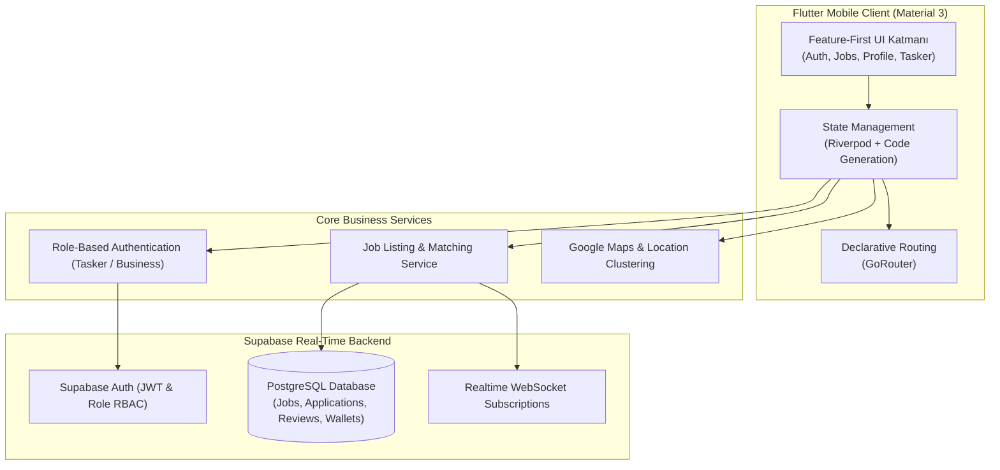

# 📱 HyerTR — On-Demand Staffing & Gig Economy Platform

[](https://flutter.dev/)
[]()
[](https://supabase.com/)
[]()

**HyerTR** is an on-demand hourly staffing and gig economy mobile application tailored for the Turkish service industry (restaurants, hotels, logistics, events, retail). It seamlessly connects businesses needing immediate staff with verified taskers (waiters, baristas, warehouse workers, cleaners) using real-time job matching, geolocation, and escrow milestone tracking.

---

## 🏛️ System Architecture & Tech Stack



---

## 🚀 Key Features

- **Dual-Sided User Roles:**
  - **Taskers (Çalışanlar):** Browse real-time nearby gigs, view hourly rates, apply with one-tap, track work history and earnings.
  - **Businesses (İşverenler):** Create instant shift requests, review applicants, check ratings, and manage shift check-in/check-out.
- **Feature-First Architecture:** Clean modular codebase following best practices (`features/auth`, `features/jobs`, `features/profile`, etc.).
- **Real-Time Database & Auth:** Powered by Supabase PostgreSQL with Row Level Security (RLS) policies and real-time WebSocket state synchronizations.
- **Dynamic Theming:** Native support for Material 3 Light and Dark modes.
- **Interactive Geolocation:** Google Maps integration for proximity-based job discovery.

---

## 🛠️ Tech Stack Details

- **Framework:** Flutter 3.x (Dart 3.x)
- **State Management:** Flutter Riverpod (with `@riverpod` annotations and code generation)
- **Navigation:** GoRouter
- **Backend-as-a-Service:** Supabase (Auth, PostgreSQL, Realtime)
- **Localization:** `intl` package with Turkish date/currency formatting

---

## 💻 Getting Started

### Prerequisites
- Flutter SDK (>=3.0.0)
- Android Studio / Xcode

### Setup Instructions
```bash
# Clone the repository
git clone https://github.com/EmreAlgurr/HyerTR.git
cd HyerTR

# Install dependencies
flutter pub get

# Generate Riverpod state code
dart run build_runner build --delete-conflicting-outputs

# Run the app
flutter run
```
